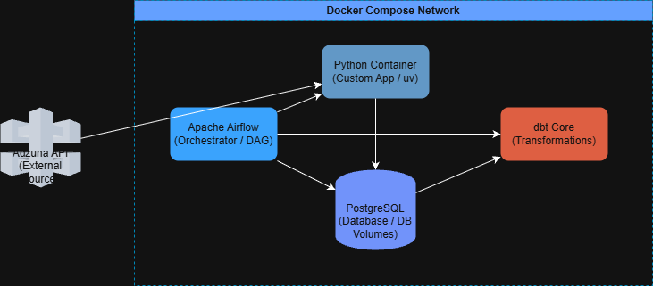

# UK Job Market Tightness Index

A cloud-deployed data engineering pipeline that tracks supply and demand across the UK job market. It ingests daily job listings from the Adzuna API, transforms them with dbt into analytical models, and surfaces salary, role demand, skills and geographic competition in a Power BI dashboard. It runs automatically every day on AWS.

Built as an end-to-end data engineering portfolio project, targeting Data Engineering roles in UK fintech and financial services.

---

## Business Problem

Where is the UK job market tightest, and where is competition lowest? A job seeker applying blindly competes everywhere. This pipeline answers the question with data by measuring advertised demand by city, role and skill, so applications can be aimed at the locations with the best opportunity.

---

## Tech Stack

| Layer | Tool | Status |
|---|---|---|
| Ingestion | Python · Adzuna API (retry with exponential backoff) | ✅ Built |
| Raw storage | AWS S3 | ✅ Built |
| Warehouse | AWS RDS (PostgreSQL) | ✅ Built |
| Transformation | dbt Core (medallion layers) | ✅ Built |
| Containerisation | Docker · AWS ECR | ✅ Built |
| Compute | AWS ECS Fargate | ✅ Built |
| Scheduling | AWS EventBridge (daily) | ✅ Built |
| Visualisation | Power BI | ✅ Built |
| Logging | AWS CloudWatch (Python and dbt logs from Fargate runs) | ✅ Built |
| Failure monitoring | AWS EventBridge | ✅ Built |
| Sponsor matching | UK Register of Licensed Sponsors | 📋 Planned |

---

## Architecture

```
EventBridge (daily schedule + failure monitoring)
    │
    ▼
ECS Fargate task  (image from ECR; Python and dbt logs streamed to CloudWatch)
    │
    └── entrypoint.sh  (fails fast on any error)
          │
          ├── 1. ingest.py ──► Adzuna API  (3 retries, exponential backoff)
          │         │
          │         ├──► raw JSON ──► S3
          │         └──► loader ──► RDS PostgreSQL  (bronze)
          │
          ├── 2. dbt run   ──► silver / gold models  (RDS)
          └── 3. dbt test  ──► data tests
                                   │
                                   ▼
                          Power BI dashboard  (gold layer)
```



> The architecture diagram above predates the AWS migration. Update it to match the flow shown here.

---

## How a Run Works

One container runs the whole pipeline in sequence. `entrypoint.sh` uses `set -e`, so a failure at any step stops the run and the task exits non-zero.

1. **Ingest**: `ingest.py` pulls the day's listings from Adzuna (about 1,500 records), retrying up to three times with exponential backoff. If zero records come back after retries, the run exits with an error rather than loading nothing.
2. **Load**: raw JSON is saved and the loader reconciles it against the existing dataset, handling new, updated and removed listings. Rejected records are written to a rejections log.
3. **Transform**: `dbt run` builds the silver and gold models.
4. **Test**: `dbt test` validates the models. Tests run after the build, so a failing test fails the task.

---

## Project Structure

```
Job_analysis/
├── analytics/            # dbt project (staging, fact and gold models)
├── pipeline/             # API client and loader modules
├── aws/                  # AWS deployment configuration
├── profiles/             # dbt profiles
├── data/raw/             # local raw JSON output
├── airflow/dags/         # legacy local orchestration (superseded, see design decisions)
├── .devcontainer/
├── ingest.py             # ingestion entry point
├── main.py
├── entrypoint.sh         # container entrypoint: ingest → dbt run → dbt test
├── Dockerfile
├── docker-compose.yml    # local development stack
├── requirements.txt
└── pyproject.toml
```

---

## Getting Started (local)

### Prerequisites

- Docker Desktop
- Adzuna API credentials ([register here](https://developer.adzuna.com/))
- A PostgreSQL instance (the local `docker-compose.yml` stack provides one)

### Setup

```bash
git clone https://github.com/Arfan10/Job_analysis.git
cd Job_analysis

# create a .env file with the variables below
docker-compose up -d
```

### Environment Variables

| Variable | Description |
|---|---|
| `ADZUNA_APP_ID` | Adzuna API application ID |
| `ADZUNA_API_KEY` | Adzuna API key |
| `POSTGRES_HOST` | PostgreSQL host |
| `POSTGRES_PORT` | PostgreSQL port (default `5432`) |
| `POSTGRES_DB` | Database name |
| `POSTGRES_USER` | Database user |
| `POSTGRES_PASSWORD` | Database password |

### Run the pipeline

```bash
# Build and run the full pipeline (ingest → dbt run → dbt test)
docker build -t job-analysis .
docker run --env-file .env job-analysis
```

In production the same image runs on ECS Fargate, triggered daily by EventBridge.

---

## Data Models (medallion architecture)

**Bronze**: raw listings as ingested from Adzuna, loaded to PostgreSQL with no transformation.

**Silver**: cleaned, typed models built with dbt.

- `stg_jobs`: cleaned and typed listings
- `stg_job_skills`: skills extracted from job descriptions via keyword matching

**Gold**: analytical models that feed Power BI.

- `fct_jobs`: job fact table
- `fct_job_skills`: skill demand fact table

---

## Key Design Decisions

**Why EventBridge + Fargate instead of Airflow?** The pipeline is a single linear sequence (ingest, load, transform, test) that runs once a day. Airflow was used during local development, but on AWS it would mean running and maintaining a scheduler, webserver and metadata database to trigger one container. EventBridge handles the schedule, Fargate runs the container on demand with nothing idle between runs, and `set -e` in the entrypoint gives sequential execution with fail-fast behaviour. If the project grows into multiple independent pipelines with real dependencies, AWS Step Functions is the next step before reintroducing a full orchestrator.

**Why dbt for transformation?** Transformation logic stays in SQL, compiles to plain SQL that runs directly on PostgreSQL, ships with built-in testing, and generates lineage documentation. A Python-script equivalent would produce the same tables with no tests and no lineage.

**Why reconcile instead of insert-only loading?** A plain `ON CONFLICT DO NOTHING` load cannot distinguish new, updated and removed listings, which led to records being wrongly treated as duplicates or missed. The loader now compares incoming data against the existing dataset so each case is handled correctly, and reruns remain safe.

**Why retry inside the ingest step?** Adzuna calls can time out or rate-limit. Retrying with backoff inside the task is cheaper and cleaner than re-triggering the whole Fargate task.

---

## Roadmap

| Phase | Focus | Status |
|---|---|---|
| 1 | Local pipeline: Docker · PostgreSQL · dbt | ✅ Done |
| 2 | AWS migration: S3 · RDS · ECR · ECS Fargate · EventBridge | ✅ Done |
| 3 | Power BI dashboard on the gold layer | ✅ Done |
| 4 | CloudWatch logging and EventBridge failure monitoring | ✅ Done |
| 5 | Sponsor matching against the UK Register of Licensed Sponsors | 📋 Planned |

---

## About

The primary portfolio project for an MSc in Data Science (Data Engineering focus), built on real public data rather than synthetic datasets.

*Built by Ayan | [LinkedIn](https://linkedin.com/in/arfanshaikh) | [GitHub](https://github.com/Arfan10)*
